# Operating Systems Laboratory

**Institution:** VNR Vignana Jyothi Institute of Engineering and Technology (VNRVJIET)  
**Laboratory:** OPERATING SYSTEMS  
**Student Roll No:** 25071A6227  

---

## Table of Contents

- [Experiment 1: FCFS and SJF Scheduling algorithms](#experiment-1-fcfs-and-sjf-scheduling-algorithms)
  - [A. without arrival times (FCFS)](#a-without-arrival-times)
  - [B. with arrival times (FCFS)](#b-with-arrival-times)
  - [A. non-preemptive (SJF)](#a-non-preemptive-sjf)
  - [B. Preemptive (SJF / SRTF)](#b-preemptive-sjf)
- [Experiment 2: Priority and Round Robin Scheduling algorithms](#experiment-2-priority-and-round-robin-scheduling-algorithms)
  - [A. non-preemptive (Priority)](#a-non-preemptive-priority)
  - [B. Preemptive (Priority)](#b-preemptive-priority)
  - [A. Time Quantum=2 (Round Robin)](#a-time-quantum2)
  - [B. Time Quantum=10 (Round Robin)](#b-time-quantum10)
- [Experiment 3: Banker’s algorithm and Analysis of the scheduling algorithms](#experiment-3-bankers-algorithm-and-analysis-of-the-scheduling-algorithms)
  - [Banker's algorithm](#bankers-algorithm)
  - [CPU Scheduling Analysis](#cpu-scheduling-analysis)
- [Experiment 4: Implementation of Memory Allocation Methods](#experiment-4-implementation-of-memory-allocation-methods)
  - [A. First Fit](#a-first-fit)
  - [B. Worst Fit](#b-worst-fit)
  - [C. Best Fit](#c-best-fit)
- [Experiment 5: Paging Technique Memory Management](#experiment-5-paging-technique-memory-management)
  - [Paging Technique Memory Management](#paging-technique-memory-management)
- [Experiment 7: frame allocation Methods](#experiment-7-frame-allocation-methods)
  - [A. minimum number of frames](#a-minimum-number-of-frames)
  - [B. equal allocation](#b-equal-allocation)
  - [C. proportional allocation](#c-proportional-allocation)
- [Experiment 8: Disk Scheduling Algorithms a) FCFS b) SSTF c) SCAN](#experiment-8-disk-scheduling-algorithms-a-fcfs-b-sstf-c-scan)
  - [A) FCFS](#a-fcfs)
  - [B) SSTF](#b-sstf)
  - [C) SCAN](#c-scan)
- [Experiment 9: Disk scheduling Algorithms a) C-SCAN b) LOOK c) C-LOOK](#experiment-9-disk-scheduling-algorithms-a-c-scan-b-look-c-c-look)
  - [A) C-SCAN](#a-c-scan)
  - [B) LOOK](#b-look)
  - [C) C-LOOK](#c-c-look)
- [Experiment 10: File Allocation Strategies](#experiment-10-file-allocation-strategies)
  - [A. Sequential](#a-sequential)
  - [B. Indexed](#b-indexed)
  - [C. Linked](#c-linked)

---

# Experiment 1: FCFS and SJF Scheduling algorithms

**Experiment No:** 1  
**Date:** 23-07-2026  
**Aim:** Write a C program for FCFS scheduling algorithm A. without arrival times, B. with arrival times, and SJF scheduling algorithm A. Non-preemptive, B. Preemptive.

---

### A. without arrival times

**Aim:** Write a C program for FCFS scheduling algorithm without arrival times.  
📄 **Source Code:** [`01_fcfs_without_arrival_time.c`](./Exp01_FCFS_and_SJF_Scheduling/01_fcfs_without_arrival_time.c)

#### Output 1
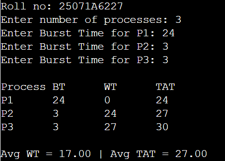

#### Output 2
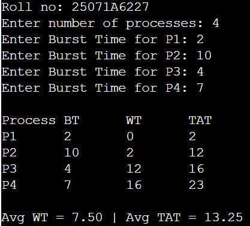

#### Output 3
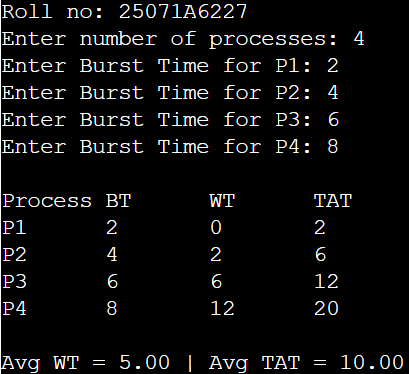

---

### B. with arrival times

**Aim:** Write a C program for FCFS scheduling algorithm with arrival times.  
📄 **Source Code:** [`02_fcfs_with_arrival_time.c`](./Exp01_FCFS_and_SJF_Scheduling/02_fcfs_with_arrival_time.c)

#### Output 1
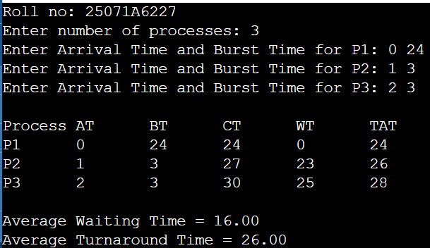

#### Output 2
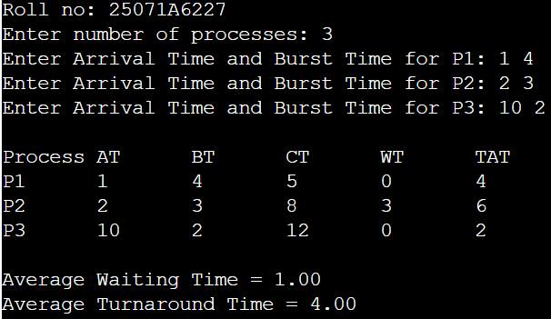

#### Output 3
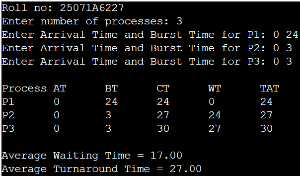

---

### A. non-preemptive (SJF)

**Aim:** Write a C program for SJF scheduling algorithm A. Non-preemptive.  
📄 **Source Code:** [`03_sjf_non_preemptive.c`](./Exp01_FCFS_and_SJF_Scheduling/03_sjf_non_preemptive.c)

#### Output 1
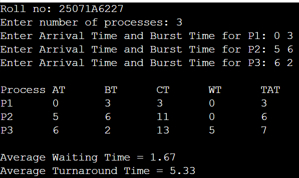

#### Output 2
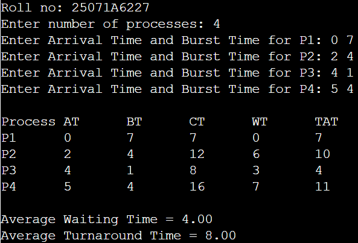

#### Output 3
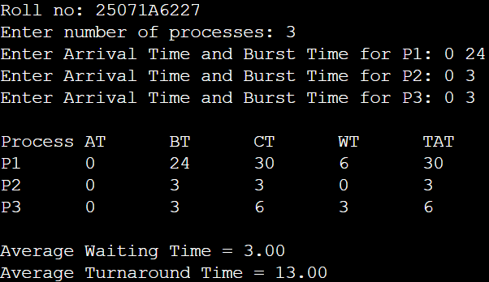

---

### B. Preemptive (SJF)

**Aim:** Write a C program for SJF scheduling algorithm B. Preemptive (SRTF).  
📄 **Source Code:** [`04_sjf_preemptive.c`](./Exp01_FCFS_and_SJF_Scheduling/04_sjf_preemptive.c)

#### Output 1
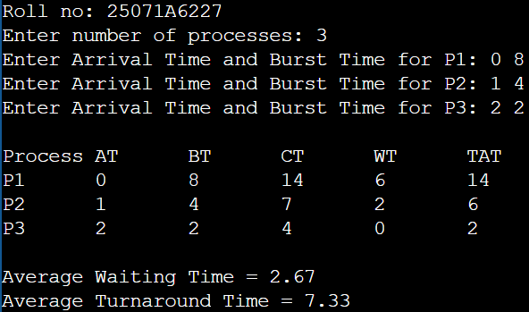

#### Output 2
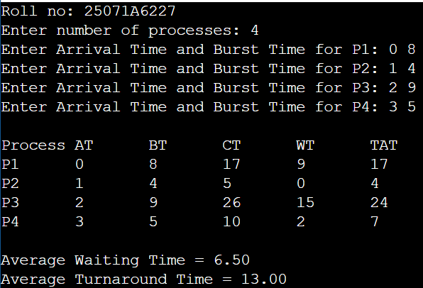

#### Output 3
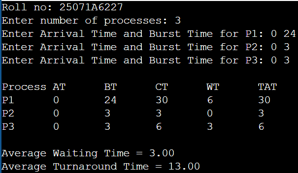

---

# Experiment 2: Priority and Round Robin Scheduling algorithms

**Experiment No:** 2  
**Date:** 30-07-2026  
**Aim:** Write a C program for Priority scheduling algorithm A. Non-preemptive, B. Preemptive, and Round Robin scheduling algorithm A. Time Quantum=2, B. Time Quantum=10.

---

### A. non-preemptive (Priority)

**Aim:** Write a C program for Priority scheduling algorithm A. Non-preemptive.  
📄 **Source Code:** [`01_priority_non_preemptive.c`](./Exp02_Priority_and_Round_Robin/01_priority_non_preemptive.c)

#### Output 1
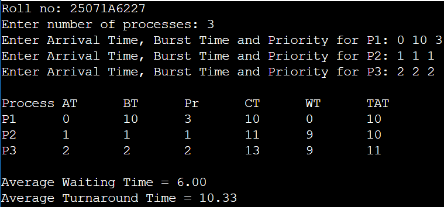

#### Output 2
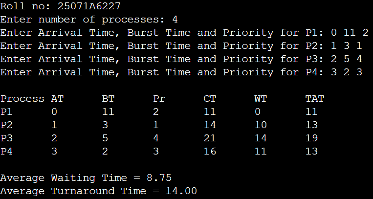

#### Output 3
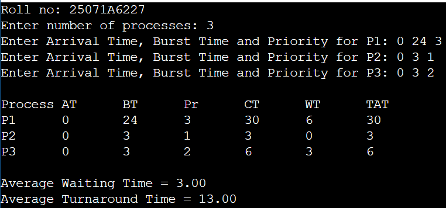

---

### B. Preemptive (Priority)

**Aim:** Write a C program for Priority scheduling algorithm B. Preemptive.  
📄 **Source Code:** [`02_priority_preemptive.c`](./Exp02_Priority_and_Round_Robin/02_priority_preemptive.c)

#### Output 1
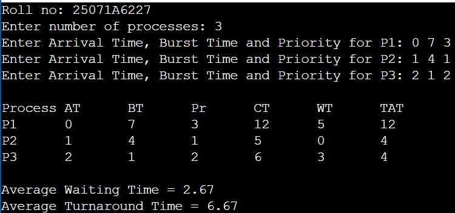

#### Output 2
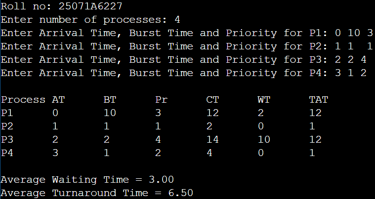

#### Output 3
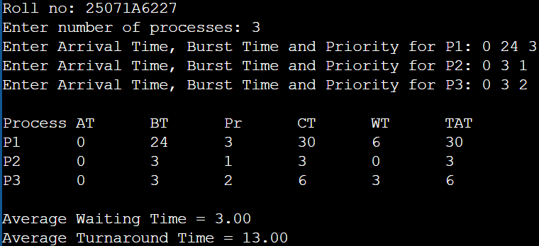

---

### A. Time Quantum=2

**Aim:** Write a C program for Round Robin scheduling algorithm A. Time Quantum=2.  
📄 **Source Code:** [`03_round_robin_tq2.c`](./Exp02_Priority_and_Round_Robin/03_round_robin_tq2.c)

#### Output 1
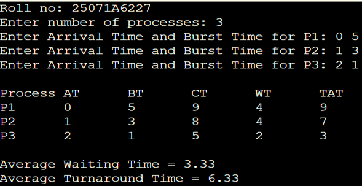

#### Output 2
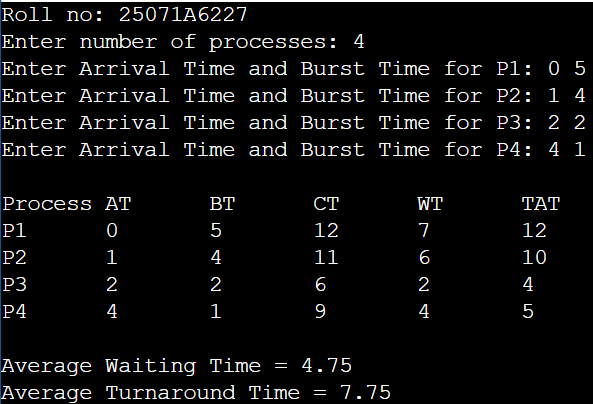

#### Output 3
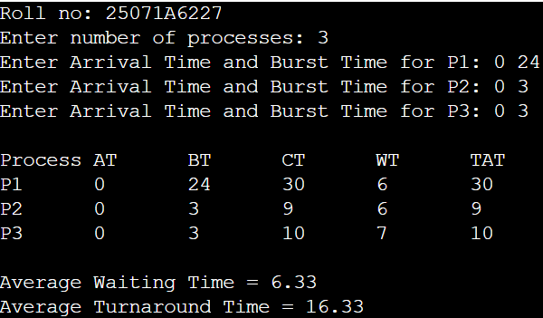

---

### B. Time Quantum=10

**Aim:** Write a C program for Round Robin scheduling algorithm B. Time Quantum=10.  
📄 **Source Code:** [`04_round_robin_tq10.c`](./Exp02_Priority_and_Round_Robin/04_round_robin_tq10.c)

#### Output 1
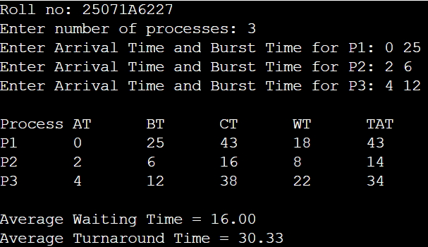

#### Output 2
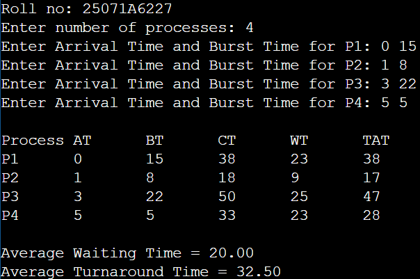

#### Output 3
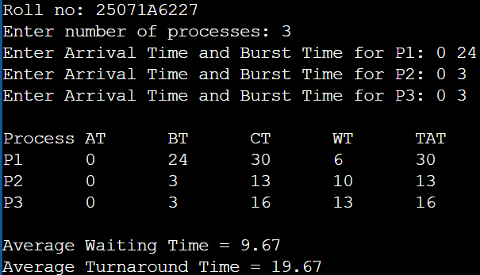

---

# Experiment 3: Banker’s algorithm and Analysis of the scheduling algorithms

**Experiment No:** 3  
**Date:** 23-07-2026  
**Aim:** Write a C program for Banker's algorithm and make the analysis of all scheduling algorithms.

---

### Banker's algorithm

**Aim:** Write a C program for Banker’s algorithm.  
📄 **Source Code:** [`bankers_algorithm.c`](./Exp03_Bankers_Algorithm/bankers_algorithm.c)

#### Output 1
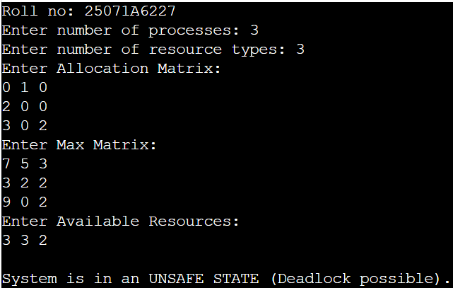

#### Output 2
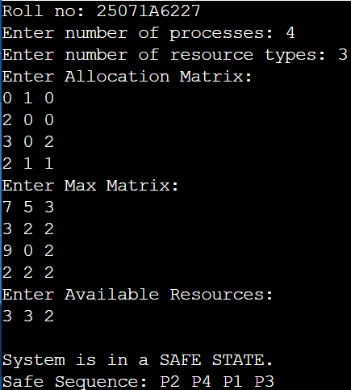

#### Output 3
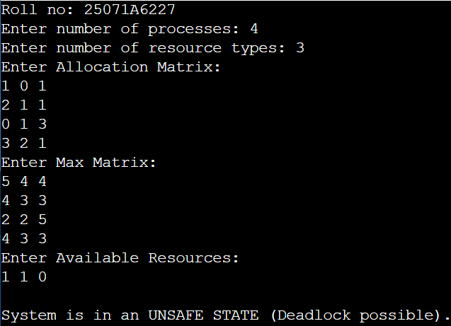

---

### CPU Scheduling Analysis

**Aim:** Make the analysis of all scheduling algorithms.

| Algorithm | Avg Waiting Time (WT) | Avg Turnaround Time (TAT) |
| :--- | :---: | :---: |
| **FCFS (No Arrival)** | 17.00 ms | 27.00 ms |
| **FCFS (With Arrival)** | 17.00 ms | 27.00 ms |
| **SJF (Non-Preemptive)** | 3.00 ms | 13.00 ms |
| **SRTF (Preemptive)** | 3.00 ms | 13.00 ms |
| **Priority (Non-Preemptive)** | 3.00 ms | 13.00 ms |
| **Priority (Preemptive)** | 3.00 ms | 13.00 ms |
| **Round Robin (Q1: TQ=2)** | 6.33 ms | 16.33 ms |
| **Round Robin (Q2: TQ=10)** | 9.67 ms | 19.67 ms |

#### Analysis Chart
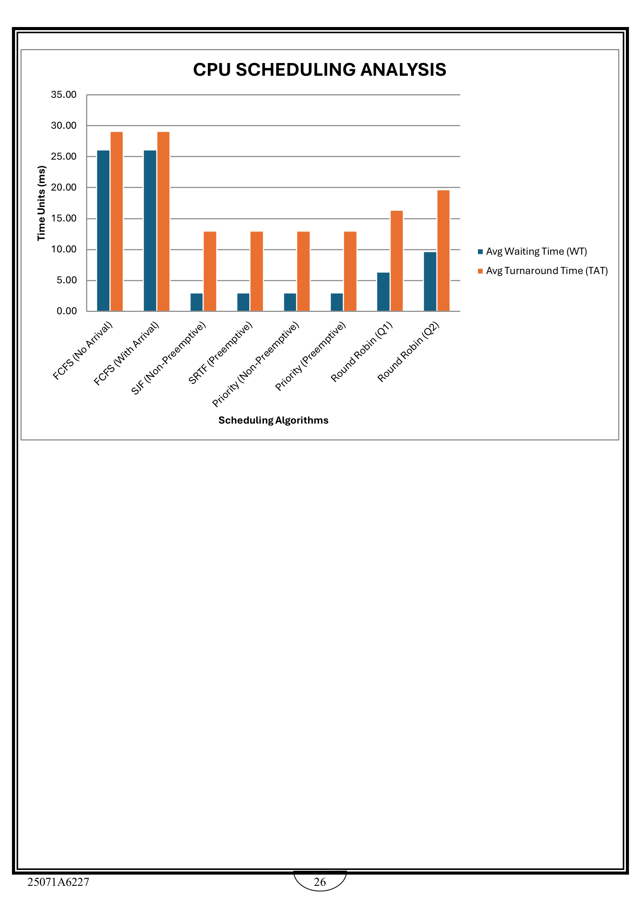

---

# Experiment 4: Implementation of Memory Allocation Methods

**Experiment No:** 4  
**Date:** 27-08-2026  
**Aim:** Implementation of the following Memory Allocation Methods for fixed partition a) First Fit b) Worst Fit c) Best Fit.

---

### A. First Fit

**Aim:** Implementation of Memory Allocation Method for fixed partition - A. First Fit.  
📄 **Source Code:** [`01_first_fit.c`](./Exp04_Memory_Allocation_Methods/01_first_fit.c)

#### Output 1
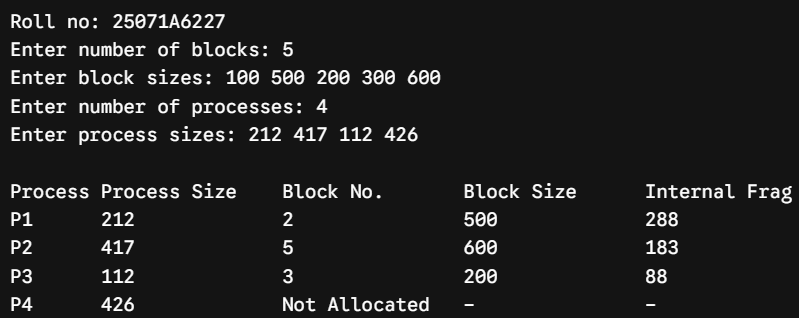

#### Output 2
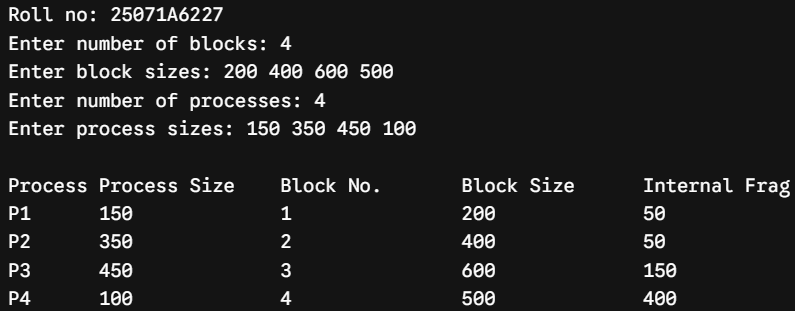

#### Output 3
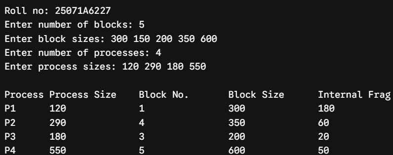

---

### B. Worst Fit

**Aim:** Implementation of Memory Allocation Method for fixed partition - B. Worst Fit.  
📄 **Source Code:** [`02_worst_fit.c`](./Exp04_Memory_Allocation_Methods/02_worst_fit.c)

#### Output 1
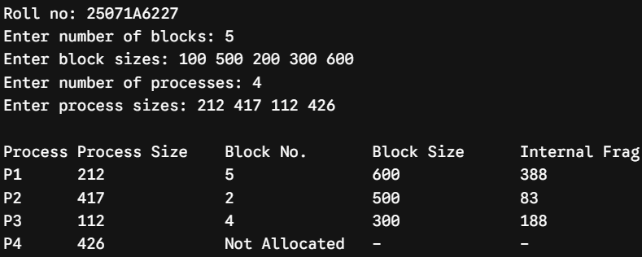

#### Output 2
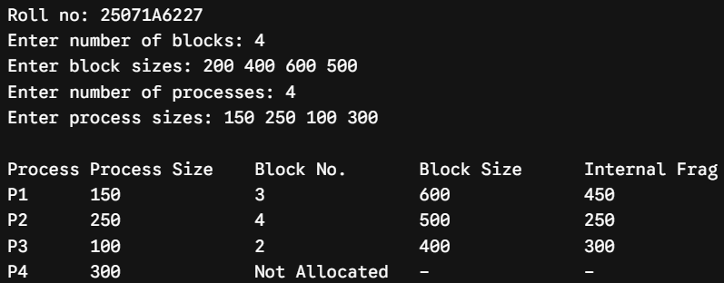

#### Output 3
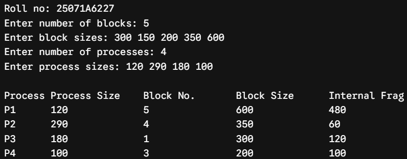

---

### C. Best Fit

**Aim:** Implementation of Memory Allocation Method for fixed partition - C. Best Fit.  
📄 **Source Code:** [`03_best_fit.c`](./Exp04_Memory_Allocation_Methods/03_best_fit.c)

#### Output 1
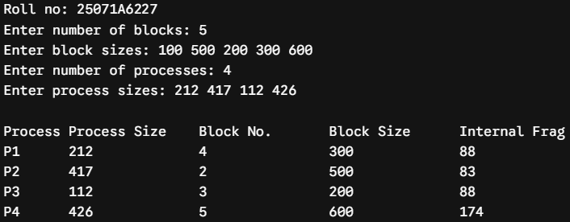

#### Output 2
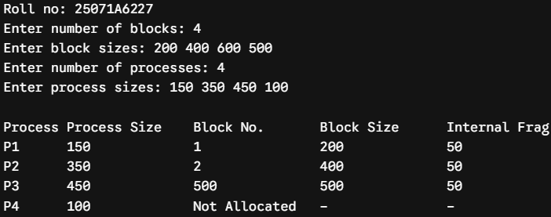

#### Output 3
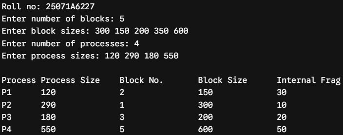

---

# Experiment 5: Paging Technique Memory Management

**Experiment No:** 5  
**Date:** 27-08-2026  
**Aim:** Implementation of Paging Technique of Memory Management.

---

### Paging Technique Memory Management

**Aim:** Implementation of Paging Technique of Memory Management.  
📄 **Source Code:** [`paging_technique.c`](./Exp05_Paging_Technique/paging_technique.c)

#### Output 1
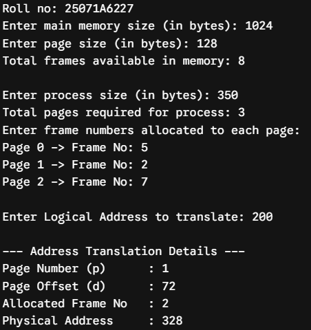

#### Output 2
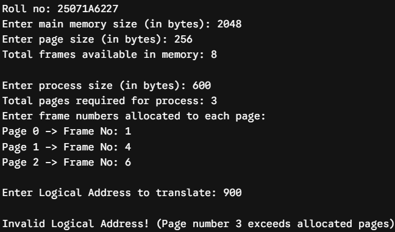

#### Output 3
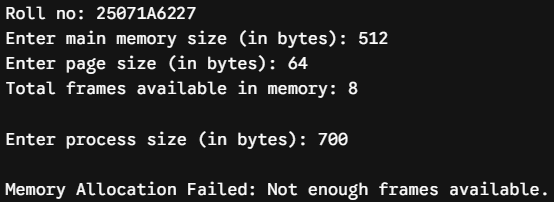

---

# Experiment 7: frame allocation Methods

**Experiment No:** 7  
**Date:** 3-09-2026  
**Aim:** Simulate frame allocation Methods. A) minimum number of frames B) equal allocation C) proportional allocation.

---

### A. minimum number of frames

**Aim:** Simulate frame allocation Methods - A. minimum number of frames.  
📄 **Source Code:** [`01_minimum_frame_allocation.c`](./Exp07_Frame_Allocation_Methods/01_minimum_frame_allocation.c)

#### Output 1
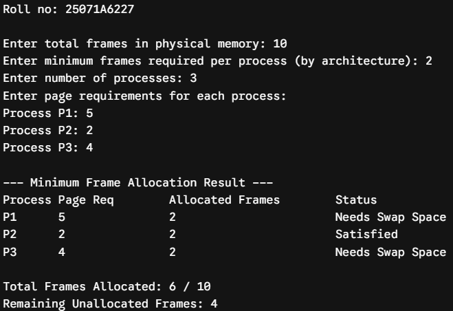

#### Output 2
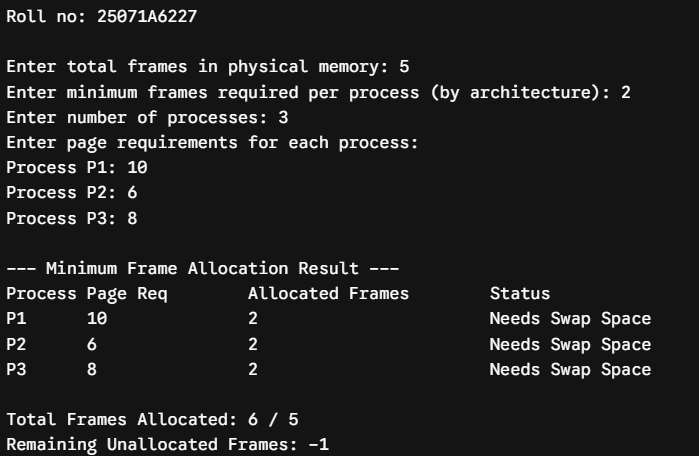

#### Output 3
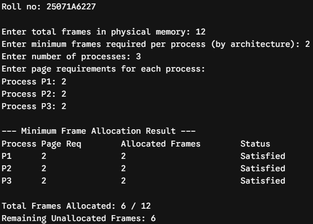

---

### B. equal allocation

**Aim:** Simulate frame allocation Methods - B. equal allocation.  
📄 **Source Code:** [`02_equal_frame_allocation.c`](./Exp07_Frame_Allocation_Methods/02_equal_frame_allocation.c)

#### Output 1

#### Output 2
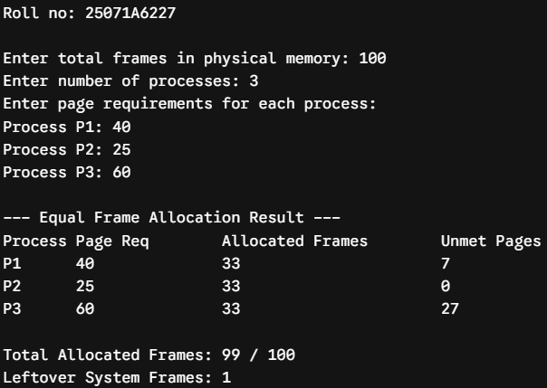

#### Output 3
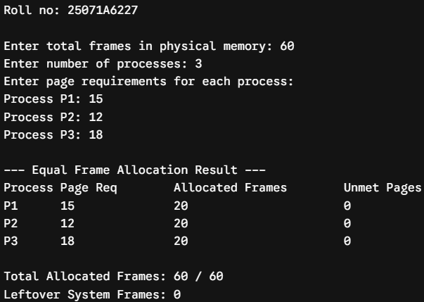

---

### C. proportional allocation

**Aim:** Simulate frame allocation Methods - C. proportional allocation.  
📄 **Source Code:** [`03_proportional_frame_allocation.c`](./Exp07_Frame_Allocation_Methods/03_proportional_frame_allocation.c)

#### Output 1
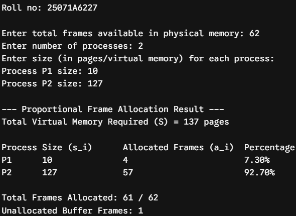

#### Output 2
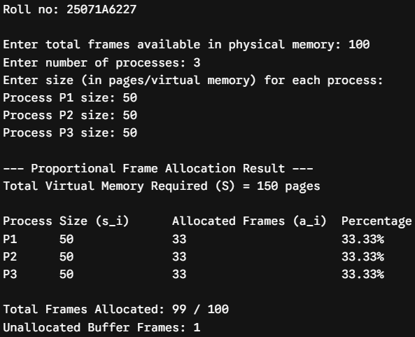

#### Output 3
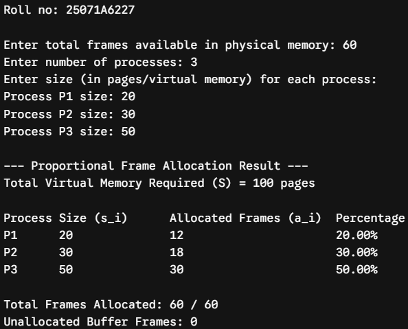

---

# Experiment 8: Disk Scheduling Algorithms a) FCFS b) SSTF c) SCAN

**Experiment No:** 8  
**Date:** 10-09-2026  
**Aim:** Simulate the following Disk scheduling algorithms. A) FCFS B) SSTF C) SCAN.

---

### A) FCFS

**Aim:** Simulate Disk scheduling algorithm - A) FCFS.  
📄 **Source Code:** [`01_fcfs_disk.c`](./Exp08_Disk_Scheduling_FCFS_SSTF_SCAN/01_fcfs_disk.c)

#### Output 1
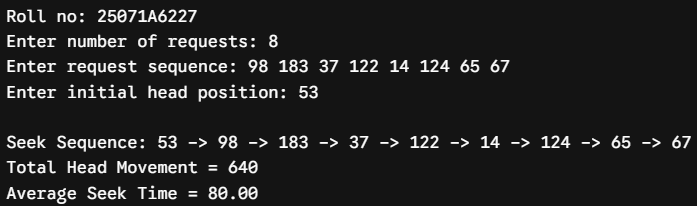

#### Output 2
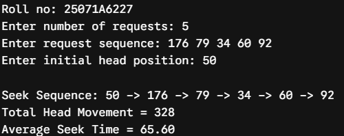

#### Output 3

---

### B) SSTF

**Aim:** Simulate Disk scheduling algorithm - B) SSTF.  
📄 **Source Code:** [`02_sstf_disk.c`](./Exp08_Disk_Scheduling_FCFS_SSTF_SCAN/02_sstf_disk.c)

#### Output 1

#### Output 2

#### Output 3

---

### C) SCAN

**Aim:** Simulate Disk scheduling algorithm - C) SCAN.  
📄 **Source Code:** [`03_scan_disk.c`](./Exp08_Disk_Scheduling_FCFS_SSTF_SCAN/03_scan_disk.c)

#### Output 1

#### Output 2

#### Output 3

---

# Experiment 9: Disk scheduling Algorithms a) C-SCAN b) LOOK c) C-LOOK

**Experiment No:** 9  
**Date:** 17-09-2026  
**Aim:** Simulate the following Disk scheduling algorithms. A) C-SCAN B) LOOK C) C-LOOK.

---

### A) C-SCAN

**Aim:** Simulate Disk scheduling algorithm - A) C-SCAN.  
📄 **Source Code:** [`01_cscan_disk.c`](./Exp09_Disk_Scheduling_CSCAN_LOOK_CLOOK/01_cscan_disk.c)

#### Output 1

#### Output 2

#### Output 3

---

### B) LOOK

**Aim:** Simulate Disk scheduling algorithm - B) LOOK.  
📄 **Source Code:** [`02_look_disk.c`](./Exp09_Disk_Scheduling_CSCAN_LOOK_CLOOK/02_look_disk.c)

#### Output 1

#### Output 2

#### Output 3

---

### C) C-LOOK

**Aim:** Simulate Disk scheduling algorithm - C) C-LOOK.  
📄 **Source Code:** [`03_clook_disk.c`](./Exp09_Disk_Scheduling_CSCAN_LOOK_CLOOK/03_clook_disk.c)

#### Output 1

#### Output 2

#### Output 3

---

# Experiment 10: File Allocation Strategies

**Experiment No:** 10  
**Date:** 24-09-2026  
**Aim:** Simulate all file allocation strategies. A. Sequential, B. Indexed, C. Linked.

---

### A. Sequential

**Aim:** Simulate File Allocation Strategy - A. Sequential.  
📄 **Source Code:** [`01_sequential_file_allocation.c`](./Exp10_File_Allocation_Strategies/01_sequential_file_allocation.c)

#### Output 1

#### Output 2

#### Output 3

---

### B. Indexed

**Aim:** Simulate File Allocation Strategy - B. Indexed.  
📄 **Source Code:** [`02_indexed_file_allocation.c`](./Exp10_File_Allocation_Strategies/02_indexed_file_allocation.c)

#### Output 1

#### Output 2

#### Output 3

---

### C. Linked

**Aim:** Simulate File Allocation Strategy - C. Linked.  
📄 **Source Code:** [`03_linked_file_allocation.c`](./Exp10_File_Allocation_Strategies/03_linked_file_allocation.c)

#### Output 1

#### Output 2

#### Output 3

